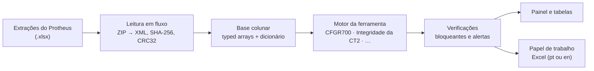

<div align="center">


# AuditAnalyzer

**Plataforma de análises contábeis do TOTVS Protheus, 100% no navegador.**

Cada ferramenta lê o seu tipo de extração, reconcilia linha a linha, responde às perguntas de auditoria interna/SOX
e gera um papel de trabalho em Excel pronto para revisão.

[](https://github.com/Carlosdanyell/AuditAnalyzer/actions/workflows/pages.yml)


[**Abrir o aplicativo**](https://carlosdanyell.github.io/AuditAnalyzer/) ·
[Manual do usuário](public/ajuda.html) ·
[Plataforma e módulos](docs/MODULOS.md) ·
[Histórico de versões](CHANGELOG.md)

</div>

---

> [!IMPORTANT]
> **Nenhum dado sai do computador.** Não há servidor, analytics, CDN nem fontes externas: o aplicativo é um conjunto
> de arquivos estáticos e a política de segurança do navegador (`connect-src 'self'`) bloqueia qualquer envio.
> Os dados ficam só na memória da sessão; o IndexedDB guarda apenas a configuração, as justificativas e as
> preferências da tela.

## Ferramentas

| Ferramenta | Lê | Situação |
|---|---|---|
| **Log de auditoria** (`CFGR700`) | Relatório CFGR700 do Protheus (tabela CT2), um ou mais `.xlsx` de até ~1 milhão de linhas | Em uso desde a 1.0.0 |
| **Integridade da CT2** (`CT2`) | Extração da tabela CT2 (lançamentos), um ou mais `.xlsx` | Prévia na 2.0.0: completa, em conferência com extrações reais |

A plataforma recebe outras ferramentas contábeis (por exemplo, conciliações) pelo mesmo contrato
([`docs/MODULOS.md`](docs/MODULOS.md)): cada uma traz as próprias regras, telas e planilha e usa a casca, a marca, a
leitura em fluxo, a rastreabilidade e as verificações comuns.

## O que cada ferramenta responde

**Log de auditoria (CFGR700)**

| Pergunta de auditoria | Onde aparece |
|---|---|
| Quais lançamentos e documentos foram **excluídos**, **alterados**, **postados** ou estão **desbalanceados** no período? | Painel e Resumo, por origem (manual, automático, misto) |
| A alteração mudou conteúdo ou foi só efetivação/carimbo de usuário? | Critério de corte das alterações |
| O que ocorreu em **pré-lançamento (9)** e o que ocorreu **após a postagem (1)**? | Modo **Segregado** e aba Segregacao |
| O mesmo usuário incluiu e efetivou o documento? | Segregação de funções, por documento |
| Todo documento excluído ou alterado tem justificativa? | Justificativas, com cobertura por arquivo e período |
| Nada ficou de fora? | Reconciliação de linhas, eventos e 15 invariantes verificados a cada execução |

**Integridade da CT2**

| Pergunta de auditoria | Onde aparece |
|---|---|
| A extração está completa e legível? | Reconciliação de linhas por arquivo, valores e chaves legíveis, colunas encontradas |
| Débito = crédito em cada documento, lote e dia, por tipo de saldo e moeda? | Testes B1–B3; B4/B5 indicam a compensação pelo documento vizinho |
| Há linhas incoerentes, duplicadas, fora do período ou em dia não útil? | Testes I1–I5 e E1–E6, com a lista de exceções |
| Como se distribuem os lançamentos por rotina, lançamento padrão e origem? | Perfil (P1–P4) e os 10 maiores documentos |
| A planilha prova os números sozinha? | Papel de trabalho **amarrado por fórmulas**: mudar a tolerância ou o período nos Critérios recalcula testes e status |

## Como funciona



Todo o processamento pesado roda em um **Web Worker**; a tela recebe só agregados e páginas de linhas, e continua
responsiva com arquivos de cerca de 1 milhão de linhas.

## Recursos

<table>
<tr>
<td width="50%" valign="top">

**Plataforma**
- Console: trilho com as visões, trilha, indicadores-chave da análise e barra de status
- Configuração própria de cada ferramenta e feriados comuns, com cópia de segurança única
- Aviso quando o arquivo parece ser de outra ferramenta
- Tema claro e escuro; fontes servidas pelo próprio app

**Leitura e integridade**
- SHA-256 de cada arquivo; CRC32 e tamanho de cada parte do ZIP
- Reconciliação: linhas após o cabeçalho − cabeçalhos repetidos − linhas em branco = linhas de detalhe
- Vários arquivos na mesma análise, com alerta de sobreposição e dias sem extração

</td>
<td width="50%" valign="top">

**Painel e tabelas**
- Cada número abre a tabela com exatamente aquelas linhas
- CFGR700: períodos, data de corte, modo **Geral** ou **Segregado**, sinalizações, justificativas
- CT2: segmento (tipo de saldo e moeda), parâmetros reaplicados em segundos, quadro de testes

**Papel de trabalho em Excel**
- Resumo vivo por fórmulas, critérios editáveis, exceções, dados e rastreabilidade
- Português ou inglês; datas como datas do Excel, valores em reais
- Verificação bloqueante impede a exportação sem confirmação registrada
- Mesma entrada + mesma configuração = mesma saída

</td>
</tr>
</table>

## Uso

1. Abra o [aplicativo](https://carlosdanyell.github.io/AuditAnalyzer/) no Chrome ou no Edge. Não há instalação.
2. Em **Ferramentas**, abra a análise; carregue uma ou mais extrações (`.xlsx`), em ordem cronológica, e clique em
   **Analisar**.
3. Confira a **Reconciliação** e navegue pelo **Painel** e pelas **Tabelas**; no CFGR700, registre as
   **Justificativas**.
4. Clique em **Exportar planilha** e escolha o idioma (e, no CFGR700, o escopo).

O passo a passo de cada ferramenta está no [manual do usuário](public/ajuda.html), também disponível no botão
**Ajuda** do aplicativo.

## Desenvolvimento

Requer Node.js 20.19 ou superior.

```bash
npm ci
npm run dev         # servidor de desenvolvimento
npm run test        # testes com arquivos sintéticos (rodam no CI)
npm run test:e2e    # ponta a ponta no navegador (Playwright, build de produção)
npm run lint
npm run build       # build de produção para o GitHub Pages
```

`npm run test:local` roda os testes com os arquivos reais em `local/`, pasta que **não é versionada**: o repositório
é público e contém apenas dados sintéticos.

| Documento | Conteúdo |
|---|---|
| [`docs/MODULOS.md`](docs/MODULOS.md) | Plataforma de análises: contrato dos módulos e o que uma ferramenta nova traz |
| [`docs/REGRAS_CFGR700.md`](docs/REGRAS_CFGR700.md) | Regras de negócio e invariantes do log de auditoria |
| [`docs/REGRAS_CT2_INTEGRIDADE.md`](docs/REGRAS_CT2_INTEGRIDADE.md) | Regras, testes e planilha da Integridade da CT2 |
| [`docs/ROTEIRO.md`](docs/ROTEIRO.md) | Fases de desenvolvimento e situação |
| [`docs/ARQUITETURA.md`](docs/ARQUITETURA.md) | Leitura em fluxo, armazenamento colunar, motor, exportação |
| [`docs/INTERFACE.md`](docs/INTERFACE.md) | Comportamentos obrigatórios das telas e padrão visual |
| [`docs/MEDICOES.md`](docs/MEDICOES.md) | Tempo e memória medidos |
| [`CLAUDE.md`](CLAUDE.md) | Restrições e convenções para quem contribui |

**Stack:** Vite · React 18 · TypeScript strict · Web Worker · TanStack Virtual · zod · hash-wasm · fflate ·
Vitest · Playwright. Fontes Sora, Geist e Geist Mono (SIL OFL, em `public/licencas`).

---

<div align="center">
<sub>Desenvolvido por Carlos Danyell</sub>
</div>
